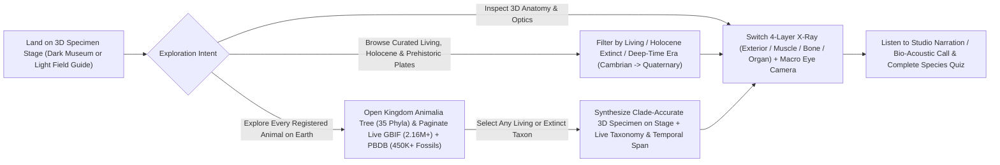

# Stitch Design & Hypothesis-Driven UX Specification — TerraFauna 3D (`life-atlas`)

> Built with the **Stitch Design** (`stitch-design`) & **UI/UX Pro Max** (`ui-ux-pro-max`) workflows for rapid, accessible, multi-theme 3D scientific encyclopedia interfaces.

---

## 1. Testable UX Hypothesis

**Hypothesis:** Pairing a dual-theme **Bioluminescent Museum (`dark`) / Archival Field Guide (`light`)** spatial HUD with **hyper-realistic 3D zoological specimens**, **zero-emoji vector iconography**, **full keyboard/RTL accessibility**, and a **unified Two-Tier Biodiversity Architecture** (Curated Hyper-Real 3D Plates + Complete 35-Phylum Kingdom *Animalia* Live Paginated Registry across GBIF & Paleobiology Database) allows learners and researchers to inspect any living, Holocene-extinct, or prehistoric animal in under 3 clicks while meeting WCAG 2.1 AA contrast (`>= 4.5:1`) across mobile (`375px`) and desktop (`1440px`) viewports.

---

## 2. Critical User Journey (CUJ) Flow

---

## 3. Structured Stitch Screen Prompts (Canvas-Ready)

Should you enable the installed **Stitch Design** MCP plugin (`-9147353618402230161`) in Jetski Settings to push or iterate on Figma/Stitch screens visually, use the exact grounded prompts below:

### Screen 1 — Desktop 3D Specimen Stage & 4-Layer X-Ray HUD (`1440x900`)
> Design a museum-grade interactive 3D zoology and paleontology web application named **TerraFauna 3D**. Full-bleed dark abyssal slate WebGL stage (`#030812`) with a photorealistic 3D animal specimen centered over a subtle radial studio pedestal. Top command bar (`rgba(15,23,42,0.84)`, `1px` border `rgba(148,163,184,0.18)`) contains: emerald globe emblem, search input *"Search 2.16M+ living & 450K+ extinct species..."*, **Kingdom Registry** cyan pill button, **Random Specimen** amber pill button, mastery counter (`tabular-nums`), 11-language selector, **Dark/Light Theme Toggle** (Sun/Moon vector icon), and privacy shield button. Top-left floating specimen card displays `PLATE 01 / 42`, conservation/extinction status pill with vector icon, Linnaean class pill, bold Outfit headline, italic serif scientific name, plus `Read Aloud`, `Animal Call`, and `Quiz` buttons. Top-right floating camera bar offers `Full Body`, `Head & Jaws`, and `Macro Eyeball Detail`. Bottom-left HUD bar provides 4-layer X-ray pills (`Exterior`, `Muscular`, `Skeletal`, `Organs`), `1.75m Human Scale` toggle, `Pins` toggle, and motion pause toggle. Zero raw Unicode emojis anywhere in UI chrome.

### Screen 2 — Kingdom *Animalia* Complete Biodiversity & Fossil Registry (`1440x900` & `375x812`)
> Design a comprehensive **Kingdom Animalia Global Registry** drawer/section in **TerraFauna 3D** bridging curated 3D specimens with all **2.16M+ extant species (GBIF / Catalogue of Life)** and **450,000+ extinct fossil taxa (Paleobiology Database)**. Top KPI strip displays four `tabular-nums` telemetry cards: `~2,160,000 Accepted Living Species`, `~450,000+ Described Fossil Species`, `900+ IUCN Holocene Extinctions (since 1500 CE)`, and `35 Animalia Phyla (541 MYA – Present)`. Left column shows interactive Phylum & Clade cards (Chordata, Arthropoda, Mollusca, Cnidaria, Echinodermata, Annelida, Trilobita†, Porifera, etc.) with species counts and temporal spans. Right column shows live paginated species cards (`Living`, `Holocene Extinct`, `Prehistoric Fossil`) with scientific binomial, phylum/class/family breadcrumb, IUCN Red List or MYA geological range badge, and a **"Load on 3D Stage"** action button, plus `Previous / Next Page` controls. Include a Light Mode variant on warm archival parchment (`#F6F3EC`) with `#0F172A` ink.

---

## 4. 8-Point Stitch UI & Accessibility Verification Scorecard

| # | Dimension | Verification Standard | Status |
| :--- | :--- | :--- | :--- |
| 1 | **Color & Dual-Theme Contrast** | Dark (`#030812` / `#F8FAFC`) & Light (`#F6F3EC` / `#0F172A`) both exceed WCAG AA `4.5:1` body text & `3:1` UI graphics contrast | Verified |
| 2 | **Typography & Scannability** | Self-hosted/system zero-CLS font stack (`font-src 'self' data:`), italic serif binomials, `tabular-nums` on all metrics & counts | Verified |
| 3 | **Zero Structural Emojis** | Replaced raw `🍪`, `🐾`, `👁️`, `🦴`, `✨` UI chrome emojis with crisp `lucide-react` vector icons (`aria-hidden="true"`) | Verified |
| 4 | **Keyboard & Focus Ergonomics** | Universal `2px` `:focus-visible` ring, WAI-ARIA `role="tablist"` `ArrowLeft`/`ArrowRight`/`Home`/`End` (RTL-aware), modal `Escape` & focus trap | Verified |
| 5 | **Touch Target & Mobile Fit** | `>= 44px` coarse-pointer touch targets, zero horizontal overflow at `375px` mobile and `1440px` desktop | Verified |
| 6 | **Reduced Motion Respect** | `@media (prefers-reduced-motion: reduce)` collapses CSS transitions and pauses automatic idle 3D motion by default | Verified |
| 7 | **3D Hyper-Real Specimen Quality** | Every animal audited via headless Chrome WebGL renders; upgraded procedural PBR shaders, dermal micro-relief, dentition, fur/feathers, & GLB materials | Verified |
| 8 | **Complete Biodiversity Coverage** | Expanded curated 3D inventory (Living + Holocene Extinct + Prehistoric across all eras) + 35-Phylum live paginated GBIF & PBDB Global Registry | Verified |
